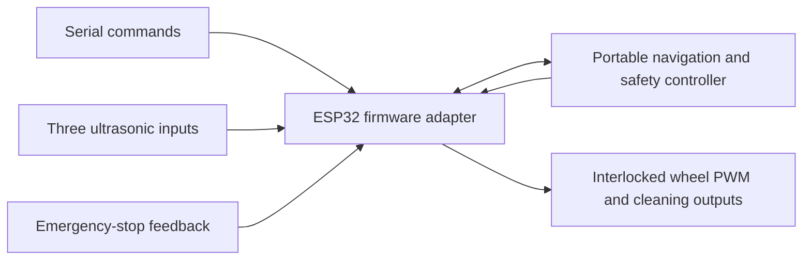
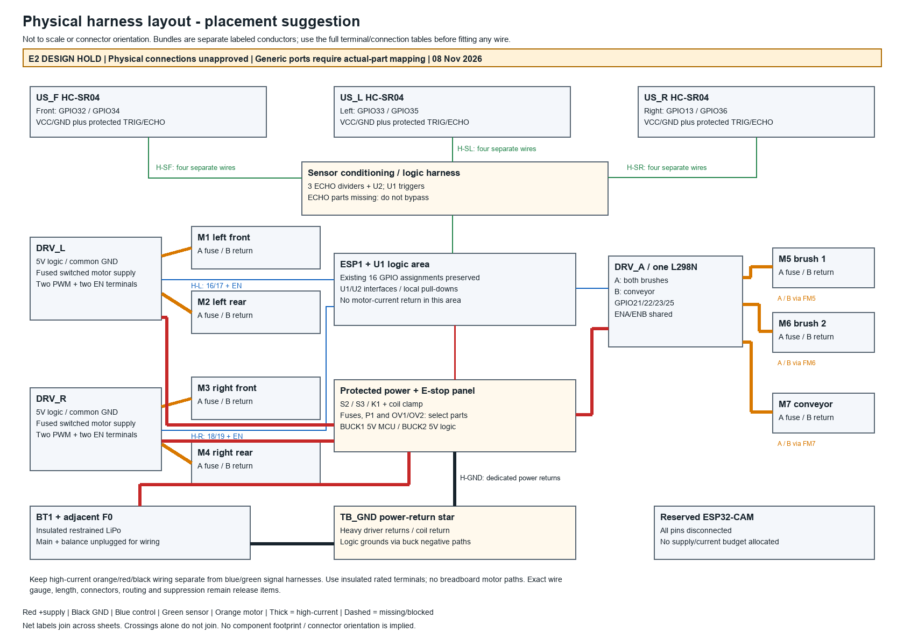

# Autonomous Garbage Collector

**University team handover:** [assembly PDF](artifacts/TEAM_ASSEMBLY_HANDOVER.pdf), [start-here instructions and evidence forms](docs/TEAM_HANDOVER.md), [exact hardware photos needed](docs/hardware_photos/README.md). Unpowered mounting/labeling and identified detached interface work can proceed through the checkpoints; physical power-up HOLD remains. Seven handover regression tests supplement the unchanged 119-test E2 baseline.

An ESP32-based autonomous waste collection rover with four wheel motors, two brushes controlled together, a separately controlled conveyor, and three ultrasonic sensors for obstacle avoidance. This repository contains the firmware, PlatformIO configuration, Wokwi control-signal simulation, automated tests, and the provisional E2 electrical design package.

**Physical hardware has not been electrically verified. Electrical assembly release remains on HOLD.** Real HC-SR04 ECHO connections must remain disconnected until suitable signal conditioning and measured voltage compatibility are established. Wokwi wiring is a simulation abstraction and must not be copied directly into physical hardware.

Current engineering package: [final verdict](docs/FINAL_GO_NO_GO.md), [review](docs/ENGINEERING_REVIEW_E2.md), [sectional wiring](docs/READY_TO_WIRE.md), [purchase list](docs/FINAL_PURCHASE_LIST.md), [23-case simulation procedure](docs/SIMULATION_VERIFICATION.md). E2 adds MCU-powered ECHO isolation without GPIO or firmware changes. **DESIGN NO-GO (HOLD); PHYSICAL POWER-UP NO-GO (HOLD)** until actual safety parts, motor/battery data and hardware evidence exist.

## Verification status

| Scope | Result and limits |
| --- | --- |
| Firmware compilation | Both `esp32dev` and `wokwi_compile` environments pass |
| Automated host tests | **119 pass:** 82 C++ controller/adapter tests, 10 Python waveform-checker, 17 electrical-model and 10 audit-export regression tests |
| Static consistency | Firmware, 16 unique GPIO assignments, generated Wokwi sketch and simulation connections agree |
| Electrical exports | All 201 connections, SVG terminals and corrected labels/statuses agree; all 31 PDFs pass strict offset/readability checks. Combined PDF: 38 pages; no physical approval |
| Wokwi runtime | Owner reports successful startup, three distance readings, ARM/AUTO, forward travel, left/right avoidance, brushes, conveyor and emergency-stop/no-restart; no independent CLI runtime or quantitative waveform run is claimed |
| Physical rover | **Untested.** No hardware upload or motor/battery activation performed during software verification |

Detailed evidence and remaining checks: [TEST_MATRIX.md](TEST_MATRIX.md). The [electrical audit and correction record](docs/FINAL_ELECTRICAL_AUDIT.md) documents closure of F01–F03 while retaining every physical HOLD. Logs are in [artifacts/](artifacts/). Build success and simulation results do not qualify motor currents, wiring, voltage levels or protection hardware.

## Hardware

| Component | Quantity | Proposed role |
| --- | --- | --- |
| ESP32-WROOM-32 DevKit | 1 | Main controller |
| 12 V, 30 RPM DC wheel motor | 4 | Two left and two right wheels |
| BTS7960 / IBT-2 module | 2 | One bridge per parallel wheel pair |
| HC-SR04 ultrasonic module | 3 | Front, left and right ranging |
| 12 V brush motor | 2 | Both on L298N channel A |
| L298N dual H-bridge module | **1** | Shared brushes on A; independent conveyor on B |
| Conveyor motor | 1 | Rated voltage/current still to be established |
| LM2596 buck converter | 2 | Separate proposed regulated 5 V MCU and logic supplies |
| 11.1 V, 3300 mAh LiPo | 1 | Proposed 3S pack; actual ratings/protection remain unverified |
| ESP32-CAM | Reserved | Future phase; currently disconnected and unassigned |

The confirmed inventory has **no divider resistors or level shifters**. Required physical interfaces and protection additions are identified in the [BOM](electrical/bom.csv) and [electrical blockers](docs/ELECTRICAL_BLOCKERS.md). Shared L298N suitability remains unverified until combined brush current, conveyor load and module thermal limits are established.

## Features

- Disabled startup, explicit ARM, latched STOP/ESTOP, and RESET without automatic movement.
- Autonomous obstacle avoidance using a non-blocking settle/turn/reassessment state machine.
- Motor direction interlocking with 100 ms disabled neutral time before new motion.
- Turns targeting 540 ms of enabled output, fresh readings after stopping, clearance hysteresis and a three-attempt limit.
- Invalid/stale sensor protection in autonomous mode and a 1.2 s manual movement timeout.
- Independent brush and conveyor requests, enabled only during actual armed forward motion.
- Serial state/distance telemetry and Wokwi logic-analyzer outputs.

Physical direction, stopping distance, runtime and cleaning performance are unverified. No encoders, rear/cliff sensing, current/jam monitoring, battery monitoring or waste recognition are implemented. Serial ESTOP disables driver outputs; independent hardware power removal requires the additional qualified circuit described in the electrical package.

## Software architecture



| Location | Responsibility |
| --- | --- |
| [include/rover_control.h](include/rover_control.h) | Portable navigation, arming, stop latches, timeouts and cleaning policy |
| [include/rover_pins.h](include/rover_pins.h) | Authoritative GPIO assignments |
| [firmware/rover.ino](firmware/rover.ino) | ESP32 sensing, serial parser, PWM and physical I/O adapter |
| [src/main.cpp](src/main.cpp) | PlatformIO entry point and environment selection |
| [wokwi/](wokwi/) | Generated standalone sketch, virtual circuit and simulator configuration |
| [test/](test/) | Controller, firmware-adapter, waveform-checker and electrical-model tests |
| [electrical/](electrical/) | Canonical physical net model, BOM, connections and current-budget worksheet |
| [scripts/](scripts/) | Sketch synchronization, verification, export generation and optional simulator scenarios |

The standalone Wokwi sketch is generated from the canonical headers and firmware. Edit canonical sources, then run `python3 scripts/sync_wokwi.py`; the checker detects drift. Firmware and GPIO assignments were preserved when preparing this repository.

## Build and test

Use Python 3 and a C++ compiler for native host tests. PlatformIO downloads the pinned toolchain on first use. From the repository root on macOS/Linux:

```sh
git clone https://github.com/Coder909-byte/autonomous-garbage-collector-.git
cd autonomous-garbage-collector-
python3 -m venv .venv
.venv/bin/python -m pip install -r requirements-dev.txt -r requirements-design.txt
.venv/bin/python scripts/verify.py
```

`verify.py` runs consistency checks, electrical-model checks, the complete host suite, both firmware builds, and Wokwi lint when the CLI is installed. It does not upload firmware or open a physical serial port. Run PlatformIO operations sequentially.

To compile only:

```sh
.venv/bin/pio run -e esp32dev -e wokwi_compile
```

To run host tests separately:

```sh
.venv/bin/pio test -e native
python3 -m unittest discover -s test -p 'test_*.py' -v
```

Pinned versions: PlatformIO Core 6.1.18, Espressif32 6.12.0, Arduino-ESP32 2.0.17. No additional Arduino libraries are required. The Arduino 3.x compatibility branch is not compile verified. Build outputs remain local under `.pio/` and are excluded from Git.

## Wokwi simulation

Build `esp32dev`, then open the [wokwi/](wokwi/) project with Wokwi for VS Code. Alternatively, copy `sketch.ino`, `diagram.json` and `libraries.txt` into an ESP32 project in the Wokwi web editor. Sensor sliders set the front/left/right distances; switch LEFT is healthy and RIGHT requests stop.

The circuit contains no resistor components. Virtual LEDs and direct virtual ECHO connections represent digital signals; there is no motor-current, mechanical, battery or protection-electronics model.

Use Serial Monitor at **115200 baud**, one command per line with Newline:

```text
ARM
AUTO
BRUSH ON
CONVEYOR ON
STOP
RESET
ARM
AUTO
ESTOP
```

ARM alone remains stopped. Both STOP and ESTOP latch a disarm. RESET requires healthy feedback and never arms or moves the rover. Brush/conveyor requests are independent and activate only during forward travel. See the [operating guide](docs/OPERATING_GUIDE.md) for manual commands, cleaning control, analyzer channels and detailed timing behavior.

Eight optional automated Wokwi scenarios can be generated without a token:

```sh
python3 scripts/run_wokwi.py --prepare-only
```

Executing them requires Wokwi CLI and `WOKWI_CLI_TOKEN` configured privately in the local environment:

```sh
python3 scripts/run_wokwi.py
```

The prepared cases are not recorded as executed. Never commit the token or put it in a sketch/configuration file. The [turning review](docs/TURNING_REVIEW.md) explains bounded STOPPED/LEFT or STOPPED/RIGHT cycles when simulated distances remain blocked.

## Electrical schematic and wiring

[](docs/diagrams/physical_wiring.pdf)

| Document | Contents |
| --- | --- |
| [Complete electrical package PDF](docs/diagrams/electrical_package.pdf) | 38 pages of terminal schematics, diagrams and connection tables |
| [FINAL_WIRING.md](docs/FINAL_WIRING.md) | 201 proposed pin-to-pin connection rows, terminal dispositions and BOM |
| [ASSEMBLY_GUIDE.md](docs/ASSEMBLY_GUIDE.md) | 80 numbered steps across nine gated commissioning stages |
| [ELECTRICAL_BLOCKERS.md](docs/ELECTRICAL_BLOCKERS.md) | Missing parts/data and unresolved release conditions |
| [Diagram index](docs/diagrams/INDEX.md) | All editable SVG, PDF and PNG exports |
| [Electrical audit](docs/ELECTRICAL_AUDIT.md) | Actual-source GPIO/interface review |
| [Reference record](electrical/SOURCES.md) | Component sources and their limits |

All important PDF/SVG diagrams are versioned. KiCad was unavailable during design; these are terminal-level vector schematics, with no KiCad ERC, PCB layout or approved footprint claim. Unknown protection assemblies use clearly labeled functional ports pending actual part selection.

Optional export regeneration and validation:

```sh
.venv/bin/python -m pip install -r requirements-design.txt
.venv/bin/python scripts/generate_wiring.py
.venv/bin/python scripts/check_design_exports.py
```

## Physical hardware status

**No physical connection is approved by this repository.** Exact module terminal mapping, GPIO reset behavior, interface loading, motor running/start/stall currents, shared L298N heating, fuse/wire ratings, battery protection, independent DC cutoff, suppression, regulated rails and USB backfeeding remain open.

Keep real ECHO connections insulated/disconnected. Do not bypass missing protection blocks, hard-wire driver enables HIGH or pass motor current through a breadboard. The physical guide defines future staged tests; its existence is not a physical pass or authorization for automatic motor activation.

## Repository contents and credentials

Firmware, PlatformIO configuration, simulation sources, tests, existing documentation, electrical source data and designed PDF/SVG/PNG exports are included. Local environments, downloaded tools, compiled binaries, simulation traces, editor state and redundant ZIP packages are excluded. Selected verification logs are retained as evidence.

API keys, Wi-Fi passwords, access tokens and Wokwi tokens belong outside versioned files. `.gitignore` excludes common credential paths; review staged changes before every commit. No network credentials are needed by the current firmware.

## S1 laptop and camera system (10 November 2026)

The local USB bridge, React dashboard, separate camera firmware and native C++ offline simulator are now included. Start with [laptop setup](docs/LAPTOP_CONTROL_SETUP.md), [system architecture](docs/SYSTEM_ARCHITECTURE.md), [camera wiring](docs/CAMERA_WIRING.md), [serial protocol](docs/SERIAL_PROTOCOL.md), [full audit](docs/FULL_CODEBASE_AUDIT.md) and [implementation report](docs/FINAL_SYSTEM_IMPLEMENTATION_REPORT.md).

```sh
npm ci
npm run sim:build
npm run build
npm start
```

Open http://127.0.0.1:8787 and select Offline simulator. The dashboard explicitly labels simulation and shows no fake camera feed. For development, run `npm run bridge` and `npm run dashboard` in separate terminals. Full unpowered verification: `.venv/bin/python scripts/verify_system.py`.

The E2 201-record wiring sources and 74-page handover remain frozen. S1 adds a canonical additive system model and camera power sheet (`electrical/system_design.json`, generated `system_netlist.json` and `system_connections.csv`): 211 total records, 206 external and five internal inspections. Hardware release remains HOLD. Actual camera-board identity, power/current qualification, main firmware installation, real serial/video and physical safety acceptance remain pending. Do not use historical E2 software counts/build sizes as the result for the new S1 software; see the current report/logs.
