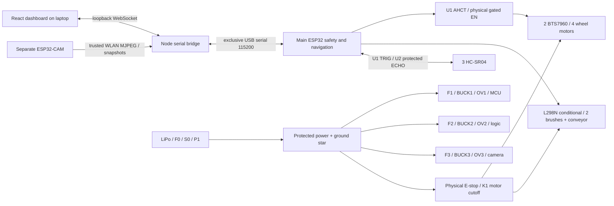

# Full rover system — S1

[Single-page architecture PDF](diagrams/system_architecture.pdf) · [SVG](diagrams/system_architecture.svg) · [camera electrical sheet](diagrams/camera_power.pdf) · [unchanged detailed E2 electrical package](diagrams/electrical_package.pdf).

Main ESP32 firmware controls GPIO14 gating, GPIO27 active-HIGH feedback, neutral interval, manual timeout, autonomous sensing and forward-only cleaning. Laptop requests pass through those existing decisions. Video is independent and cannot directly issue motor commands. No Bluetooth or Wi-Fi motor-control capability is assumed. No physical movement sensor exists; applied output is software adapter state. [Protocol and stop limits](SERIAL_PROTOCOL.md).

The loopback bridge uses one browser operator, validates commands, leases held motion, exposes versioned telemetry and proxies only numeric private camera addresses on fixed ports/paths. The dashboard never fabricates sensor distances or a live camera feed. Simulator runs the same C++ Controller, MotionGate, LineParser and telemetry serializer in a child process; it replaces physical boundaries only. Simulated healthy feedback is synthetic. It does not prove GPIO waveform behavior or real safety performance.

## Electrical source hierarchy

E2 `electrical/design.json`, `connections.csv`, terminal map, diagrams and 74-page team PDF are retained. `electrical/system_design.json` is the **canonical additive S1 source**, pinning E2 source hashes and defining camera additions. `scripts/generate_system.py` uses the existing Drawing renderer to generate `system_netlist.json`, `system_connections.csv`, system manifest and two readable new sheets. The combined S1 netlist has all seven motors, interfaces, grounds, protection and the camera. It supersedes E2's statement that CAM1 is reserved only for this proposed S1 branch; it does not approve hardware.

W001-W201 are identical, including four internal inspections. W202-W211 add nine conductors and one BUCK3 internal inspection: **211 total records, 206 external, five internal inspections**. `scripts/check_system.py` and mutation tests reject camera power from MCU/raw battery/switched motor rail, parallel output rails, ground loss, duplicate wires and main-GPIO changes. Laptop USB and Wi-Fi are communication links `LINK-USB` / `LINK-VIDEO`, not fabricated internal USB conductor pin assignments.

No actual electrical connection was changed. E2 driver ratings, U1/U2 qualification, actual module/header maps, P1/OV1/OV2/K1 selection, USB backfeed, contact reliability, motor current and stopping-distance holds remain. S1 adds BUCK3/F3/OV3/C_CAM selection, board identity, camera current/thermal and WLAN isolation holds. See [updated requirements](UPDATED_HARDWARE_REQUIREMENTS.md). Camera output is never silently added to an existing supply budget.

The frozen E2 handover remains historically accurate for its original source. Its validator verifies archived firmware against Git `2da0b0a`; current firmware/controller tests and Wokwi synchronization separately validate the telemetry extension. It still rejects modifications to live E2 wiring, GPIOs and controller logic. All energized commissioning stages remain unreleased.
